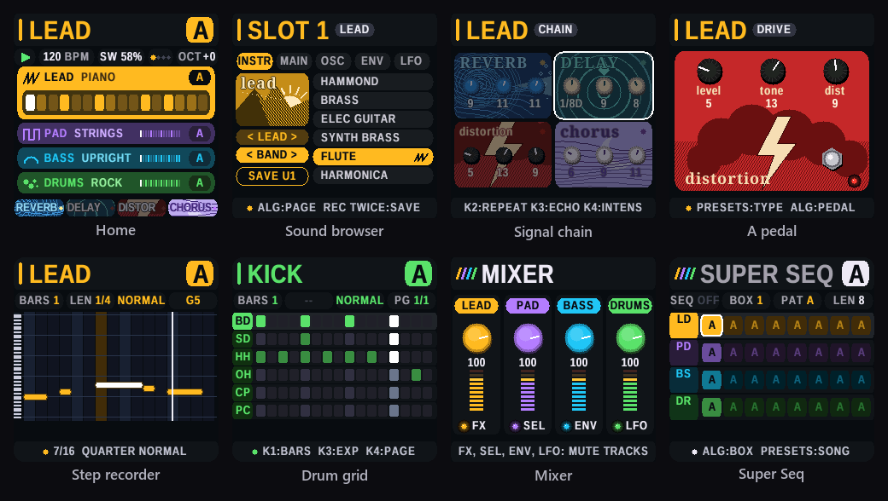

<p align="center"></p>

# QUARTET

A four-track groovebox for the M-VAVE FM-1 built around traditional instruments and effects pedals that simulates a four-piece band: lead, pads, bass and drums. Featuring 72 sounds and 23 drum kits (plus your own), ten patterns per instrument, 30 pedals, live recording, and a song sequencer where each instrument follows its own arrangement.

<p align="center"></p>

## What it does

- **Four tracks**: three synth slots, each a LEAD, PAD or BASS (they start as LEAD, BASS, PAD; two of a kind show as
  L1 / L2), sharing nine voices, and DRUMS. Each type has its own colour.
- **10 patterns per track** (A-J), 1 to 4 bars, with swing, every note with a length (1/16 to a whole bar) and an expression. A new
  pattern starts when the playing one comes round.
- **Step recorder and live recorder**: write notes step by step, or play them in while the music runs; live notes
  are placed on the beat.
- **72 sounds**, six in each of four groups per type: lead KEYS (piano, music box ...), BAND (Hammond, brass, guitar), SYNTH
  (Mini Lead, Sync Lead ...) and ODD (theremin, glass harp); pad STRINGS, KEYS, SYNTH and ATMOS; bass ACOUSTIC (upright,
  slap ...), ANALOG (Moog, 303 line ...), DIGITAL (DX, Reese) and WILD (fuzz, wobble, growl). From a 2-oscillator synth with pulse
  width modulation, hard sync, FM, glide, a resonant filter, envelope and LFO. Every sound can be tweaked and **saved to
  a USER bank** (8 per type, 4 drum kits).
- **23 drum kits**: GROOVE (Rock, Hip-Hop, Lo-Fi, Breaks, Jazz, Funk), MACHINES (CR-78, Mini Pops, LM-1, 606, 808, 909),
  ELECTRO (Electro, Techno, Trap, House, Dub, Industrial) and ODD (Toy, Glitch, Metal, Noise, Kitchen): synthesised, with toms,
  congas, shakers and more on PERC, and the LM-1 played from samples of a real Linn LM-1 (rossf, Sampling+ 1.0: see
  [LICENSING.md](LICENSING.md)).
- **Four pedal slots** per track (tap FX, SEL, ENV, LFO: on / off), each holding any of **30 pedals**, each drawn as a screen-printed pedal with its own art: drives (distortion, overdrive,
  fuzz, octave fuzz, wavefolder, bitcrusher), filters (filter sequencer, wah), modulation (chorus, phaser,
  flanger, tremolo, slicer, vibrato, pump), space (reverb, delay, tape echo, shimmer, reverse delay, spring reverb),
  pitch (shifter, harmonizer) and oddities (old media, glitch, underwater, synth, lo-fi, loose, music box).
- **Arpeggiator** (rate, octaves, direction), locked to the beat, for the keys and for the recorded patterns.
- **Sound editor** (EDIT): the slot's type, group and sound on a browser page (INSTR), every synth's oscillators, filter,
  envelope, LFO and glide, each drum; REC twice saves to the USER bank. EDIT again: the **signal chain**, the sound
  and its four pedals in order, each switched, swapped and tuned from one page.
- **Copy a pattern** from any synth slot into another (hold SEQ in the step recorder), so the pads can take the lead's
  tune.
- **The same controls everywhere**: SELECT the track, ALGORITHM moves within a page, KNOB1 the on/off switch, a tap or a
  hold, REC twice to confirm.
- **Expression on every note**: normal, soft, loud, short, punch, smooth (glides on into the next note) or plucked,
  per note and per drum hit. Hold OCT- / OCT+ to move a whole pattern an octave.
- **Beat repeat**: hold GLO and the slice playing goes round (1/2 bar down to 1/32); let go and the music is where it
  would have been.
- **Key page**: the key's signature and scale, a scale lock for the keys and the key's notes lit on them.
- **Mixer** with mutes.
- **SUPER SEQ**: chain each track's patterns into songs (10 songs, 8 boxes per track).
- **4 save slots** for the whole groovebox, and your current work is kept by itself across power-offs.
- **Safe to update**: USB updates, a USB rescue mode (hold **OCT-** while switching on), and a boot guard.

How to play it, step by step: **[the user guide](docs/USER_GUIDE.md)**.

## Install

Get `quartet-X.Y.fwsc` from the [releases](../../releases) (or, for the newest test build, the `quartet-fwsc`
artifact of the latest run under [Actions](../../actions)). Then either:

- **[M-Flasher](https://github.com/jvitkauskas/m-flasher)** (Windows, macOS, Linux): connect the FM-1, press
  **DOWNLOAD MODE**, **back up the whole flash first**, then **Install firmware (.fwsc)**. The backup puts
  everything back exactly as it was, whenever you want.
- **`tools/fm1_install.py`** over USB-MIDI: `pip install mido python-rtmidi`, then
  `python tools/fm1_install.py quartet-X.Y.fwsc` (`--info` shows what the FM-1 runs now).

The FM-1 then reports itself as `FM-1_988` (QUARTET, every release).

**Going back**: restore your M-Flasher backup, or install M-VAVE's official `FM-1.fwsc`. QUARTET keeps its songs in
the parts of the flash the stock firmware uses for its presets, so without a backup the stock presets may need
*System → Reset Patches*.

**If something goes wrong**: hold **OCT-** while switching on for the USB rescue, then install again. Don't switch
off or unplug while an install is writing.

Installing firmware is at your own risk. QUARTET is not made or endorsed by M-VAVE.

## Build it

Every push to `main` is built on GitHub (Actions), with the host tests; a tag `vX.Y` also publishes a release with a
build attestation. To build yourself (Linux, or Docker): the JieLi toolchain (`tools/get_toolchain.sh`), the AC79
SDK (`AC79NN_SDK_V1.2.1_2023-12-13`) and Pillow, then `./build.sh` -> `build/quartet.fwsc`.

Without the FM-1: `tests/run_host.sh` runs the firmware on your computer (the screens as PNG, the sound as WAV).

```
firmware/src/quartet.c     the groovebox: the screens, the controls, the data, saving
firmware/src/gb_clock.h    the master clock, the patterns, SUPER SEQ
firmware/src/gb_synth.h    LEAD, PAD, BASS: the synth engine and its sounds
firmware/src/gb_drums.h    DRUMS: the drums and the kits
firmware/src/gb_fx.h       the pedals and the mixer
firmware/src/platform.c    the platform (boot, USB, MIDI, updates, audio, storage), from Dinghy
docs/development/          how it was planned and built, the platform's API and the chip's rules
```

## Built on

QUARTET is built on **[Dinghy](https://github.com/zvenson/dinghy)** by zvenson, which carries the platform of
**[Felucca](https://github.com/hugelton/Felucca)** by Leo Kuroshita (Hügelton Instruments) with the changes of
**[SLOOP](https://github.com/isod89/sloop-fm1)** (isod89), OberVave's storage and loader screen (zvenson), the
SMK-37 layer of M. Geisler (genkigenki) and the loader idea of [Skiff](https://github.com/illuminus5/skiff)
(illuminus5). Thank you all.

## License

GPL-3.0-only, like everything it is built on: you may use, change and share it, and whoever gets a firmware built
from it gets its source too. Who made what, and the third-party parts: [LICENSING.md](LICENSING.md).
