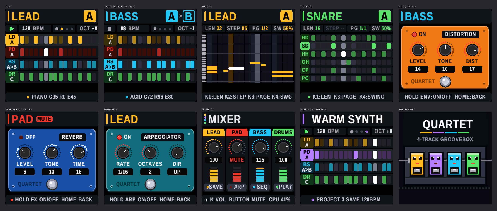

<p align="center"></p>

# QUARTET

A four-track groovebox for the M-VAVE FM-1 built around traditional instruments and effects pedals that simulates a four-piece band: lead, pads, bass and drums. Featuring 40 sounds, ten patterns per instrument, live recording, and a song sequencer where each instrument follows its own arrangement.

<p align="center"></p>

## What it does

- **Four tracks**: LEAD (4 voices), PAD/CHORDS (4 voices), BASS and DRUMS, each in its own colour.
- **10 patterns per track** (A-J), 16 to 64 steps, with swing. A new pattern starts when the playing one comes round.
- **Step recorder and live recorder**: write notes step by step, or play them in while the music runs; live notes
  are placed on the beat.
- **10 sounds per instrument**: piano, brass, Hammond, theremin, strings, choir, handpan, acid bass, Reese, wobble and more, from a 2-oscillator synth with a resonant filter, envelope and LFO. Every sound can be tweaked.
- **10 drum kits**: Rock, Hip-Hop, Mini Pops, CR-78, LM-1, 606, 808, 909, Lo-Fi and Industrial: synthesised, with toms,
  congas, shakers and more on PERC, and the LM-1 played from samples of a real Linn LM-1 (rossf, Sampling+ 1.0: see
  [LICENSING.md](LICENSING.md)).
- **Five pedals** per track, drawn as stompboxes: reverb, delay, distortion, chorus, phaser.
- **Arpeggiator** (rate, octaves, direction), for the keys and for the recorded patterns.
- **Mixer** with mutes.
- **SUPER SEQ**: chain each track's patterns into songs (10 songs, 8 boxes per track).
- **4 save slots** for the whole groovebox, and your current work is kept by itself across power-offs.
- **Safe to update**: USB updates, a USB rescue mode (hold **OCT-** while switching on), and a boot guard.

How to play it, step by step: **[the user guide](docs/USER_GUIDE.md)**.

## Install

Get `quartet-X.Y.fwsc` from the [releases](../../releases) (or, for the newest test build, the `quartet-fwsc`
artifact of the latest run under [Actions](../../actions)). Then either:

- **[M-Flasher](https://github.com/jvitkauskas/m-flasher)** (Windows, macOS, Linux): connect the FM-1, press
  **DOWNLOAD MODE**, **back up the whole flash first**, then **Install firmware (.fwsc)**. The backup puts
  everything back exactly as it was, whenever you want.
- **`tools/fm1_install.py`** over USB-MIDI: `pip install mido python-rtmidi`, then
  `python tools/fm1_install.py quartet-X.Y.fwsc` (`--info` shows what the FM-1 runs now).

The FM-1 then reports itself as `FM-1_988` (QUARTET, every release).

**Going back**: restore your M-Flasher backup, or install M-VAVE's official `FM-1.fwsc`. QUARTET keeps its songs in
the parts of the flash the stock firmware uses for its presets, so without a backup the stock presets may need
*System → Reset Patches*.

**If something goes wrong**: hold **OCT-** while switching on for the USB rescue, then install again. Don't switch
off or unplug while an install is writing.

Installing firmware is at your own risk. QUARTET is not made or endorsed by M-VAVE.

## Build it

Every push to `main` is built on GitHub (Actions), with the host tests; a tag `vX.Y` also publishes a release with a
build attestation. To build yourself (Linux, or Docker): the JieLi toolchain (`tools/get_toolchain.sh`), the AC79
SDK (`AC79NN_SDK_V1.2.1_2023-12-13`) and Pillow, then `./build.sh` -> `build/quartet.fwsc`.

Without the FM-1: `tests/run_host.sh` runs the firmware on your computer (the screens as PNG, the sound as WAV).

```
firmware/src/quartet.c     the groovebox: the screens, the controls, the data, saving
firmware/src/gb_clock.h    the master clock, the patterns, SUPER SEQ
firmware/src/gb_synth.h    LEAD, PAD, BASS: the synth engine and its sounds
firmware/src/gb_drums.h    DRUMS: the drums and the kits
firmware/src/gb_fx.h       the pedals and the mixer
firmware/src/platform.c    the platform (boot, USB, MIDI, updates, audio, storage), from Dinghy
docs/development/          how it was planned and built, the platform's API and the chip's rules
```

## Built on

QUARTET is built on **[Dinghy](https://github.com/zvenson/dinghy)** by zvenson, which carries the platform of
**[Felucca](https://github.com/hugelton/Felucca)** by Leo Kuroshita (Hügelton Instruments) with the changes of
**[SLOOP](https://github.com/isod89/sloop-fm1)** (isod89), OberVave's storage and loader screen (zvenson), the
SMK-37 layer of M. Geisler (genkigenki) and the loader idea of [Skiff](https://github.com/illuminus5/skiff)
(illuminus5). Thank you all.

## License

GPL-3.0-only, like everything it is built on: you may use, change and share it, and whoever gets a firmware built
from it gets its source too. Who made what, and the third-party parts: [LICENSING.md](LICENSING.md).

You can also try Quartet in the browser, no flashing needed, in the free community [FM-1 Emulator](https://fm1-emulator.atst.tools/).
