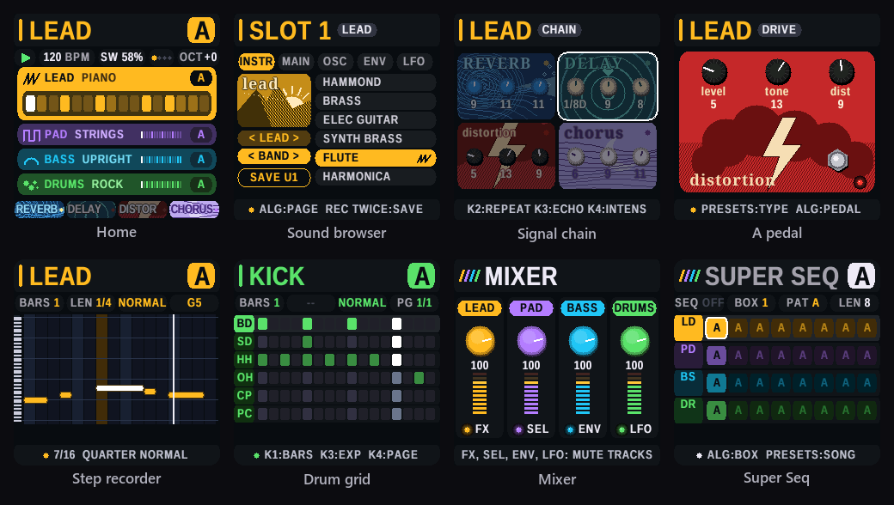
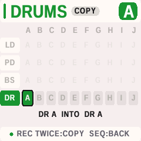
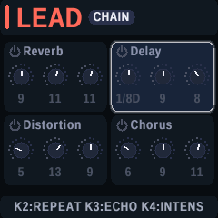
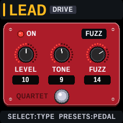
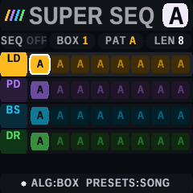
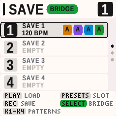

# QUARTET
## User guide for the M-VAVE FM-1

**Four instruments. One little band.**

Quartet is a four-track groovebox with **lead, pads/chords, bass and drums**, 72 sounds and 23 drum kits in groups, ten patterns per instrument, four pedal slots each with a library of 40 pedals, live recording and a song arranger.

> **On a fresh install, a short demo groove is loaded** in pattern A of each instrument. Press **PLAY** to hear it and explore. To start from empty, **hold REC** on the home screen for the **RECORD** page, turn **ALGORITHM** to **CLEAR EVERYTHING**, then press **REC** twice (within three seconds). This erases the demo groove for good, but not your four saved projects.

## Instruments and home screen

**Lead** (gold) plays melodies; **pads** (violet) plays pads and chords; **bass** (cyan) plays basslines; **drums** (green) has six percussion voices. Each home pill shows its sign (a sawtooth, an arch, a square wave, dots). Muted instruments turn red.

Turn **SELECT** to choose an instrument and **ALGORITHM** to choose its sound or drum kit (one click per choice, through every group in turn; the new sound's name shows, without playing a test note). Play the keys; for drums, the first six white keys play the six sounds. **OCT− / OCT+** change octave, up to two either way: the button lights one octave down or up and blinks at two (held half a second they move the whole pattern you're editing down or up an octave) and **MASTER** sets overall volume. **PLAY** starts or stops all instruments from step one.

The **home screen** shows the selected instrument and pattern (A–J), tempo, beat lights and octave, then a pill per track in its colour: its sign, its name, its sound and its pattern. The chosen track's pill lights up and opens out with the 16 steps of the page it is playing (the playing step white); the others show theirs as a thin strip. The bottom line, set apart by a strip of black, shows the chosen track's four pedals, each a slice of its own case and art with a small LED: lit when it is on, dark (and the slice dimmed) when off. **A > C** means pattern C is queued after A.

On the home screen the four knobs are: **KNOB1** the tempo; **KNOB2** the chosen track's **mix level** (the mixer's, shown with a speaker); **KNOB3** its **brightness** (a synth's filter, the same as EDIT's cutoff, shown with a sun; on the drums it is the **kit's decay** instead, all six drums shorter or longer together, from tight to long and roomy, shown with a hit dying away); **KNOB4** the **pedal fade**, how pedals switch on and off: at once (**-**) or fading in and out over 1, 2, 3 or 4 bars (shown with a ramp). All four show on the line under the title, the bars in the track's colour. When the keys are shifted an octave, **OCT+1** (or −1, ±2) shows in the top bar. Swing is on the SONG page (below). The sound itself is shaped in **EDIT**. **PRESETS** chooses patterns, **SEQ** opens the sequencer (and SUPER SEQ), **EDIT** opens the sound editor, **GLO** opens the mixer and **SAVE** opens project storage. **HOME** always returns here.

## How the controls work

The same rules hold on every page:

- **SELECT** is always the track. **PRESETS** is the pattern, or the page's own thing (the pedal on a pedal page or the signal chain, the song in SUPER SEQ).
- **ALGORITHM** moves within the page (cursor, tab, slot, box) and never takes you to another page.
- **KNOB1–4** are the four settings shown, left to right. Where a page has an on/off switch (pedals, the arpeggiator, SUPER SEQ), it is **KNOB1**.
- **Tap or hold:** a tap switches something or opens it, a half-second hold does the other. Pedal buttons and **ARP**: tap on/off, hold for the page. **GLO**: tap the mixer, hold beat repeat. **SEQ** in the step recorder: tap SUPER SEQ, hold the copy page.
- **REC twice** confirms anything that keeps or replaces work: saving a sound or a project, copying a pattern, clearing everything. Holding **REC** (on home, the step recorder or the LIVE page) opens the **RECORD** page, where clearing a pattern or everything is chosen and confirmed.
- A page's own button again moves on or closes it (**EDIT**: sound → chain → home; **SEQ**: recorder ↔ SUPER SEQ; **GLO**: mixer → KEY → home; **SAVE**: closes). **HOME** always goes home.

## Patterns and step recording

Each instrument has **ten patterns (A–J)**, each **1 to 4 bars** (16, 32, 48 or 64 steps; a step is a 16th note) long. Turn **PRESETS** to choose one; changes during playback wait until the current pattern ends. **Hold ARP + turn PRESETS** to copy a pattern into the next letter.

Press **SEQ** to open the **step recorder** (SEQ lights up). Melodic instruments use a piano roll: move to a step and play keys to enter notes. Each note goes in at the length set on **KNOB2**, and the cursor jumps past it; hold keys together for a chord. A new note cuts off any note it would overlap. The line above the roll shows **BARS**, **LEN**, the expression and the cursor's note (**HELD** inside a longer note, **REST** on an empty step); the bottom line shows the step, the length and the expression in words, e.g. **7/16  QUARTER  SMOOTH**. For drums, the **first six black keys** choose a drum and the **white keys** toggle hits on the displayed steps.

| Control | Step recorder (synths) | Step recorder (drums) |
|---|---|---|
| **ALGORITHM** | The cursor, through every bar | — |
| **KNOB1** | **BARS**: pattern length, 1–4 bars (an empty pattern takes the length of the one you came from) | Same |
| **KNOB2** | **LEN**: note length, **1/16, 1/8, dotted 1/8, 1/4, dotted 1/4, 1/2, dotted 1/2, whole**: the note at the cursor, and the notes you write next | — |
| **KNOB3** | **EXP**: the expression, how the note is played, **NORMAL / SOFT / LOUD / SHORT / PUNCH / SMOOTH / PLUCKED** (see below) | Same, for new hits (or a held hit) |
| **KNOB4** | **NOTE**: the cursor's note or chord up / down a semitone (heard when stopped) | The bar shown |
| **OCT− / OCT+** | Tap: the keys' octave. Hold: the pattern down / up an octave | Tap: the bar shown |
| **REC tap / hold** | Switch to **LIVE** recording / the **RECORD** page (clear the pattern or everything) |
| **ARP tap / hold 0.5 s** | Tie the previous note into this step / a **rest** (the step cleared) |
| **SEQ tap / hold 0.5 s** | SUPER SEQ / the **copy page** (below) |
| **HOME** | Home |

**Expression (EXP).** Every note (and drum hit) has an expression, how it is played, on **KNOB3** in the step recorder:

| | Synths | Drums |
|---|---|---|
| **NORMAL** | As written (every note from an older save that was *f*) | As written |
| **SOFT** | Quieter (older saves' *mf*, *mp* and *p* stay as soft as they were) | Quieter |
| **LOUD** | A little louder | A little louder |
| **SHORT** | Half a step, whatever its length (staccato) | Choked short |
| **PUNCH** | Louder still and a little brighter (an accent) | Louder |
| **SMOOTH** | Held on into the next note, which glides on from it without a new attack (legato) | Left to ring |
| **PLUCKED** | A quick start, then it dies away by itself (pizzicato) | Choked short, quieter |

It changes the note under the cursor, and the notes you write next. For drums it sets new hits; to change a hit already there, **hold its white key and turn KNOB3**. On the piano roll softer notes look dimmer, a SHORT note is drawn short, a PUNCH or LOUD note has a white edge and a SMOOTH note a little tie; the bottom line names it (**7/16  8TH  SMOOTH**). Live recording writes notes as **NORMAL**.

**Moving a pattern an octave.** Hold **OCT−** or **OCT+** half a second: every note of the pattern you're editing (the chosen track's, the one PRESETS shows) moves down or up an octave (**PATTERN OCT UP**). If a note would go out of range nothing moves (**OUT OF RANGE**); drums have no pitch. A tap still changes the keys' octave.

While the music plays, a pattern longer than 16 steps is followed page by page on the display, unless you edit or change pages; it resumes following after three seconds.

**Copying a pattern** (from Conductor). Hold **SEQ** in the step recorder or the live page for the copy page: every track's patterns A–J, a pattern with notes tinted, an empty one dark, and the pattern you are editing framed white (the copy goes there). **SELECT** picks the track to copy from (synth slots copy from each other, so the pads can take the lead's tune; drums from drums) and **PRESETS** or **ALGORITHM** the pattern. **REC** asks, **REC** again copies (notes, lengths, expression and pattern length) and takes you back; **SEQ** goes back without copying.

## Beat repeat

**Hold GLO** while the music plays: the slice that is playing goes round and round (**REPEAT** shows at the top and GLO blinks) until you let go, and then the music carries on exactly where it would have been. While holding GLO, the first five **white keys** choose the slice: **1/2 bar, 1/4, 1/8 (the starting choice), 1/16, 1/32**; you can change it mid-repeat. A quick tap of GLO still opens the mixer.

## Live recording

**From home, tap REC** to record straight into the chosen track: the LIVE page opens and, if the music is stopped, a silent one-bar **count-in** runs (**4 · 3 · 2 · 1** on the top bar, REC blinking), then the music starts at step one and records. If the music is already playing, recording starts at the next bar (the beats to it count down). **Tap REC** again to stop recording while playback continues. You can also tap **REC** in the step recorder for the **LIVE** page (SEQ blinks) and **tap REC** there to start a take the same way. **PLAY** stops playback and recording; **SEQ** goes on to SUPER SEQ; **HOME** returns home.

**Undo:** each take keeps a copy of the pattern as it was. **Tap ARP** on the LIVE page to put it back (**TAKE UNDONE**): a bad pass costs nothing.

**The first take sets the length:** recording into an **empty** pattern, it starts one bar long and grows a bar each time the take reaches its end, up to four. (Chose an empty pattern while another plays? The take waits for it to come round, counting the last beats. With SUPER SEQ on, takes go into the pattern playing and keep its length.) Tap **REC** to stop: the pattern is as many bars as you played (stopping just after a bar line keeps the bar before).

**A MIDI keyboard's velocity** sets each note's expression: played softly it records as **SOFT**, normally as **NORMAL**, harder as **LOUD** and hardest as **PUNCH** (the FM-1's own keys record as NORMAL).

**The RECORD page** (hold **REC** on home, the step recorder or the LIVE page) has two choices: **CLEAR** the chosen track's pattern, or **CLEAR EVERYTHING** (every pattern, sound and pedal; saved projects stay). **ALGORITHM** chooses, **REC** asks, **REC** again does it (clearing everything takes you home). **HOME** leaves.

Notes are **added** to the pattern playing and quantised to 16th-note steps; lengths are rounded to steps. Lead and pads allow up to four notes per step, bass one. Drums use the first six white keys. On this screen **KNOB1** changes the number of bars, **KNOB2** moves the melodic cursor and **KNOB3** changes the bar shown; **KNOB4** is unused.

## Sounds and sound editing

### Instrument slots

The first three tracks are **synth slots**: each can be a **LEAD**, a **PAD** or a **BASS**, so you can run two leads, three pads, two basses and so on. The fourth track is always **DRUMS**. When two slots play the same type they are numbered: **LEAD 1 / LEAD 2** in titles and **L1 / L2** on the home screen (likewise P1, P2, B1, B2). A slot takes the colour of its type. A new project starts as LEAD, BASS and PAD, as before.

The synths share nine voices: a LEAD or PAD slot gets four, a BASS one. Three LEAD/PAD slots would need twelve, so the busiest gives one up (4 + 3 + 2 and so on). Changing a slot's type keeps its patterns (a BASS plays only the first note of each step).

### Groups

Each player's sounds come in **four groups**, by what they are, then **USER** (up to 8 of your own per type, 4 drum kits):

| Lead | | Pads | | Bass | | Drums | |
|---|---|---|---|---|---|---|---|
| **KEYS** | Piano, Xylophone, Music Box, FM Bell, Tine Keys, Clavinet | **STRINGS** | Strings, Solina, Choir, Acoustic Guitar, Harp, Digital Choir | **ACOUSTIC** | Upright, Slap, Plucked, Tuba, Fretless, Picked | **GROOVE** | Rock, Hip-Hop, Lo-Fi, Breaks, Jazz, Funk |
| **BAND** | Hammond, Brass, Electric Guitar, Synth Brass, Flute, Harmonica | **KEYS** | Electric Piano, DX Piano, Organ, Handpan, Vibes, Marimba | **ANALOG** | Moog Bass, 303 Line, Sub Bass, Synth Bass, Rubber Bass, Slide Sub | **MACHINES** | CR-78, Mini Pops, LM-1, 606, 808, 909 |
| **SYNTH** | Mini Lead, Juno Lead, PWM Lead, Acid Lead, Chiptune, Porta Lead | **SYNTH** | Juno Strings, Poly Synth, PWM Pad, Prophet Brass, Warm Analog, Warm Synth | **DIGITAL** | DX Bass, Reese, Electro Bass, FM, Deep Reese, Synth Pluck | **ELECTRO** | Electro, Techno, Trap, House, Dub, Industrial |
| **ODD** | Theremin, Glass Harp, Laser, Bowed Metal, Sine Swarm, Stepper | **ATMOS** | Drone, Frozen, Cathedral, Sweep, Glass Pad, Tidal | **WILD** | Fuzz, Wobble, Growl, Juno Bass, Womp, Dirt Bass | **ODD** | Toy, Glitch, Metal, Noise, Kitchen |

Each type has its own sounds: a slot switched to BASS chooses from the bass sounds. On the home screen, turn **ALGORITHM** to step through every sound of the slot's type, group after group (in the step recorder it moves the cursor instead). Selecting another sound loads its settings, replacing your tweaks. A sound or kit from an older save that is no longer on the list still loads and plays as it did, and shows at the top of the list while it is chosen.

The drum kits are synthesised, except the **LM-1**, which plays samples of a real Linn LM-1; on it the CLAP and PERC keys are its **low and high toms** (TL / TH on the drum grid). PERC is a different instrument per kit: a conga on CR-78, a shaker on Mini Pops and 606, a high tom on 808 and a low tom on Lo-Fi.

**Press EDIT** for the **SOUND** page, the in-depth sound editor for the chosen instrument (the button lights). It opens on the **INSTR** page, with the track's slot on top (**SLOT 1–4**, as on the home screen, its type beside it): a sound browser with a picture for the type on the left, screen-printed in two inks like a pedal with the type's name lettered on it (mountains under a sun for lead, rings for pad, stacked blocks for bass, confetti for drums), under it the type (**KNOB1**: lead, pad or bass) and the group (**KNOB2**) as pills and the USER slot to save to (**KNOB4**); on the right the group's sounds as pills (**KNOB3**), the one playing filled in the track's colour. **SELECT** moves to another instrument's page, **ALGORITHM** chooses the page, **KNOB1–4** edit it. **EDIT** again opens the **signal chain** (below), and once more goes home; **HOME** goes home at any time:

| Page | KNOB1 | KNOB2 | KNOB3 | KNOB4 |
|---|---|---|---|---|
| **INSTR** | Type: LEAD / PAD / BASS | Group | Sound in the group (e.g. 3/8) | USER slot to save to (U1–U8) |
| **MAIN** | Glide | Cutoff | Resonance | Filter envelope |
| **OSC** | Wave 1 | Wave 2 | Wave 2 tuning (−24 to +24) | Mix / FM amount |
| **ENV** | Attack | Decay | Sustain | Release |
| **LFO** | Rate | Depth | Target: pitch/filter/volume | Wave: tri/square/saw/random |

**Saving your own sound:** press **REC twice** on any page of the sound editor (within three seconds; the bottom line asks first). It saves to the USER slot named on the bottom line (**SAVE U1**); pick another with **KNOB4** on **INSTR**. **SAVED USER 3** shows and the slot now plays the saved sound, which appears in the USER bank of that type. Saving to a used slot replaces it. The USER bank is kept with your work and with each saved project, and survives *clear everything*.

**Glide** (MAIN, KNOB1) slides each note's pitch from the last one: off at 0, up to about half a second. Tempo is on KNOB1 of the home screen.

OSC waveforms: sine, triangle, saw, square, noise, FM, **pulse** (a square whose width the LFO can move: set the LFO target to **PWM**) and **sync** (wave 2 only: a saw restarted by wave 1, hard sync; the filter envelope sweeps it). For drums the first page is **KIT** (KNOB2 group, KNOB3 kit, KNOB4 USER slot, REC twice saves the kit), then a tab per drum (BD SD HH OH CP PC): **ALGORITHM** chooses the page, **KNOB1–3** the drum's pitch, decay and level.

**The signal chain (EDIT twice).** The track's four pedals as cards, in the order the sound flows through them (FX, SEL, then ENV, LFO), a pedalboard: each card is the pedal itself, a window of its art behind its lettered name, its LED and three small knobs with their values; one that is off goes dark, its LED out, and the chosen one is framed white. **ALGORITHM** moves between them and **KNOB2–4** turn the chosen pedal's knobs (named on the bottom line); **KNOB1** switches it on or off; **PRESETS** swaps it for another pedal from the whole library, category by category (one already in another slot is skipped, and a pedal that would overload the chip stays off: **CPU FULL**).

## Effects pedals and arpeggiator

The top-row buttons **FX, SEL, ENV and LFO** are **four pedal slots for the selected instrument**, and each slot can hold **any pedal from a library of 40**. **Tap** a button to switch its pedal **on or off**: its name shows at the top (**GLITCH ON**, **GLITCH OFF**) and the button is lit while it is on. **Hold** it half a second to open the pedal: **PRESETS** chooses the **type** (category, shown beside the instrument's name) and **ALGORITHM** the **pedal** within it, a click each. A pedal already in another of the instrument's slots isn't offered (it comes back when that slot changes); nor is Glitch beside Loose, as they share the instrument's sound memory. On the pedal, **KNOB1** also switches it on (a click clockwise) and off (a click anticlockwise); **KNOB2–4** adjust it. **HOME** returns to the sequencer. Every pedal is drawn like a screen-printed boutique pedal, with its own art across the case: a storm and a lightning bolt on Distortion, a volcano on Fuzz, a lighthouse on Tremolo, ripples on Delay, a night swirl on Reverb, a comet on Shimmer, tape reels on Tape Echo, a melting clock on Loose, confetti on Glitch, and so on. Its name is lettered on the case, its three knobs are coloured knurled caps or black skirted ones with their names and values underneath (digital pedals in %), and its LED glows when it is on; off, the LED goes dark with OFF beside it.

 A new project starts with Reverb, Delay, Distortion and Chorus in the four slots. (**EDIT** is no longer a pedal slot: it is the sound editor.)

| Category | Pedal | KNOB2 | KNOB3 | KNOB4 |
|---|---|---|---|---|
| **Drive** | Overdrive: soft, warm | Level | Tone | Drive |
|  | Distortion | Level | Tone | Distortion |
|  | Fuzz: hard, buzzy | Level | Tone | Fuzz |
|  | Octave Fuzz: an octave up, fuzzed | Level | Tone | Fuzz |
|  | Wavefolder: metallic, folds back on itself | Level | Tone | Fold |
|  | Bitcrusher: fewer bits and a lower sample rate, crunchy digital grit | Bits | Rate | Mix |
|  | Compressor: evens out loud and quiet; a slow attack lets each note's start through | Squash | Attack | Level |
| **Filter** | Wah: opens as you play louder | Sensitivity | Range | Resonance |
|  | DJ Filter: one knob from low-pass (muffled) through open to high-pass (thin) | Filter LP–OPEN–HP | Resonance | Level |
|  | Acid: a resonant filter that snaps open on every note (on drums: every hit) | Cutoff | Resonance | Decay |
|  | Filter Seq: the filter steps in time with the tempo | Rate 1/4–1/16 | Depth | Resonance |
| **Modulation** | Chorus | Rate | Depth | Level |
|  | Flanger: jet-plane sweep | Rate | Depth | Feedback |
|  | Phaser | Rate | Depth | Feedback |
|  | Tremolo: volume pulsing | Rate | Depth | Shape: round to square |
|  | Vibrato: pitch wobble | Rate | Depth | Mix |
|  | Slicer: rhythmic chopping, in time | Rate 1/8–1/32 | Depth | Pattern 1–8 |
|  | Pump: ducks the instrument on every kick, the sidechain "breathing" | Depth | Release | Source: kick / 1/4 / 1/8 |
|  | Rotary: a spinning-speaker cabinet that spins up or slows down as SPEED turns | Speed | Depth | Mix |
| **Space** | Reverb | Level | Tone | Time |
|  | Spring Reverb: the splashy, metallic spring of an old amp | Level | Tone | Time |
|  | Shimmer: reverb that rises in octaves | Level | Time | Shimmer |
|  | Delay | Repeat rate | Echo | Intensity |
|  | Tape Echo: wobbly, darkening repeats | Echo | Time | Repeats |
|  | Reverse Delay: backwards echoes that swell into each repeat | Echo | Time | Repeats |
| **Pitch** | Shifter: the notes moved up or down | Semitones −12…+12 | Octave −2…+2 | Mix |
|  | Harmonizer: a second note at an interval above or below | Interval (octave, 5th, 4th, 3rd, minor 3rd, down or up) | Level | Tone |
|  | Synth: a square wave following the lowest note | Octave 0/−1/−2 | Tone | Mix |
|  | Music Box: a little plucked metal bell on each note, slightly uneven | Decay | Tone | Mix |
|  | Ring Mod: the sound multiplied by a tone: metallic, bell-like | Frequency | Mix | Wobble |
| **Texture** | Old Media: a worn tape or record: wobble, hiss and crackle, a dull and squashed sound | Wear | Noise | Tone |
|  | Lo-Fi: lower sample rate, noise and a worn digital sound | Rate | Noise | Dirt |
|  | Underwater: muffled and drifting | Depth | Wobble | Level |
|  | Wrong Station: now and then tunes to a neighbouring sound (drums: kit) with a burst of static, then back | Chance | Drift (how far along the list) | Hold 1/4 bar–2 bars |
| **Behaviour** | Glitch: on a step, now and then, a slice repeats, reverses or stutters | Chance | Length 1/32–1/8 | Mix |
|  | Loose: some notes play late (now and then twice), and a second player follows a step behind | Late | Double | Drift |
|  | Mech Failure: wears out as it plays (missed and stuck notes, out of tune) until it suddenly recovers | Wear | Stick | Recovery |
|  | Memory Loss: each time round more steps are forgotten, down to a floor; Recall brings them back in waves | Speed | Floor | Recall |
|  | Tape Worm: keeps the last steps played and now and then loops a fragment of them | Chance | Length 1/8–1 bar | Repeats 1–4 |
|  | Bloom: each note starts clean and grows richer harmonics as it is held | Time | Depth | Tone |

**Pedal fade.** With KNOB4 on the home screen set to 1–4 bars, tapping a pedal on fades it in over that many bars, and tapping it off fades it out: a drive or filter blends from the clean sound to the pedal's; a space pedal (reverb, delay, …) has its send turned up or down, so its tail rings out. Set to **-**, pedals switch at once. Pressing STOP ends any fade. The note pedals (Wrong Station, Mech Failure, Memory Loss, Tape Worm) can't fade: they change notes, so they switch at once.

Most values run 0–20. **Space pedals are shared**: there is one of each (Reverb, Delay, Tape Echo, Shimmer, Reverse Delay, Spring Reverb) for the whole band. Each instrument sets **how much it sends** (Level / Echo); the other two knobs belong to the shared pedal and change it for every instrument using it. All other pedals are each instrument's own, slot by slot, and run in slot order (FX first).

**PLAY / STOP**: stopping silences every pedal at once: echoes, reverb tails, loops, Glitch, and Loose's late notes and second player all end (the space pedals fade out in a few milliseconds), and nothing left over is heard when you start again. While stopped, the pedals come back as soon as you play a key.

The chip can only do so much at once: if switching a pedal on (or choosing a heavier one) would overload it, the pedal stays off and **CPU FULL** shows. Switch another pedal off first. Rotary, Phaser, Filter Seq and Wah are the heaviest; the drives, Compressor, Tremolo, Slicer, Glitch and Synth the lightest.

The **arpeggiator** plays held notes or pattern chords in sequence. Like a pedal button, **tap ARP** to switch it on or off (**ARP ON** shows; ARP is lit while it is on) and **hold it 0.5 seconds** for its screen: **KNOB1** on/off, **KNOB2** rate (1/4–1/32), **KNOB3** octaves (1–4), **KNOB4** direction (up/down/random). Its notes are **locked to the beat**: they always fall on the grid of its rate, from the bar's start (a key pressed between two beats starts on the next).

## SUPER SEQ: song arrangements

Press **SEQ** twice (the sequencer, then SUPER SEQ) to open **SUPER SEQ**; **SEQ** again goes back to the step recorder, **HOME** home. Each instrument has its own row of up to **eight boxes**, and there are **ten songs (A–J)**. Each box plays its pattern once before moving on; instruments advance independently, so a 32-step pattern lasts twice as long as a 16-step pattern.

- **A–J:** play that pattern.
- **Blank:** repeat the previous pattern; blanks at the beginning are silent.
- **X:** rest; following blanks remain silent until another letter.

For example, `A...B.A.` plays **A A A A B B A A**. A new song starts with A followed by blanks, repeating A.

| Control | SUPER SEQ |
|---|---|
| **SELECT** | Instrument row |
| **KNOB1** | SUPER SEQ on/off |
| **ALGORITHM** or **KNOB2** | Select box |
| **KNOB3** | Blank / A–J / X |
| **KNOB4** | Song length: 1–8 boxes |
| **PRESETS** | Song A–J |
| **ARP held + PRESETS** | Copy song into next letter |

When SUPER SEQ is on, it chooses the playing patterns instead of PRESETS. **PLAY** starts at box one; enabling SUPER SEQ during playback starts each instrument at box one when its current pattern finishes.

## Mixer and saving

**GLO** opens the mixer: a channel per track, each with a knurled knob in its colour. **KNOB1–4** set the volumes of lead, pads, bass and drums, shown under the knob and as a column of LEDs. On the mixer, **FX / SEL / ENV / LFO** mute lead, pads, bass and drums: the LED by the button's name glows while the track plays and goes dark when muted. Tap **GLO** again for the **SONG page**, and once more to go home (**HOME** also goes straight home). If audio crackles, try switching a pedal off.

**The SONG page** (the key page, from Conductor) shows the key, then one line with **LOCK** and **LIGHTS** (lit when on) and the key's relative minor (e.g. **A MINOR**), then the **SWING**, and one octave of keyboard with the key's notes lit and named (the notes you play light gold). **ALGORITHM** chooses the key, a sharp or a flat at a time (C, G, D … or F, B-flat, E-flat …; QUARTET's demo groove is in C minor, the key of E-flat). **KNOB1** switches **LOCK** on: the keys then play only the key's notes, a note outside it sounding the one below. **KNOB2** switches **LIGHTS** on: the key's notes glow on the FM-1's keys (lead, pads and bass, outside the step recorder). **KNOB3** sets the **swing** for the whole song, 50 % (straight) to 66 % (a heavy shuffle), a click a step: every second 16th comes a little later, while the beat itself stays exactly in time.

Quartet **automatically remembers current work** after playback stops and the sound has been quiet for two seconds. Four separate save slots let you keep projects.

Press **SAVE**; **KNOB1** chooses slot 1–4. Press **REC twice** (second press within three seconds) to **save**, or **PLAY twice** to **load**. Loading replaces current work; an empty slot says **EMPTY**. Saving or loading stops playback. Press **SAVE** to leave the page.

To clear the current project, **hold REC** for the RECORD page, choose **CLEAR EVERYTHING** with ALGORITHM, then press **REC** twice. This resets patterns, sounds, effects, mixer, swing, arpeggiators and SUPER SEQ, **not** the four saved slots or your USER sounds. MIDI channel and octave are retained.

## Complete control reference

| Control | Playing / home | Step recorder | Other screens |
|---|---|---|---|
| **SELECT** | Select instrument | Select instrument | SUPER SEQ: select row; SOUND, chain: another instrument; copy page: the track to copy from |
| **PRESETS** | Select pattern A–J | Select pattern | SUPER SEQ: select song; pedal: the type (category); chain: another pedal; copy page: the pattern to copy from |
| **ALGORITHM** | Select sound/kit (no test note) | Melodic step cursor | Pedal: the pedal within its type; SOUND: the page; chain: the slot; copy page: the pattern; SUPER SEQ: the box; save: the slot; KEY: the key; arpeggiator, mixer: nothing |
| **KNOB1–4** | Tempo / the chosen track's mix level / its brightness (drums: kit decay) / pedal fade (0–4 bars) | Bars / note length / expression / note (drums: bars / — / expression / bar) | LIVE: bars / cursor / bar / —; SONG: lock / lights / swing; SUPER SEQ: on-off / box / pattern / length; otherwise labelled settings |
| **Keys** | Play notes; drums: first six white keys | Melodic notes; drums: black keys choose voice, white keys toggle hits | LIVE: play and record |
| **OCT− / OCT+** | Tap: octave; hold: the pattern an octave | Tap: drum step page; hold: the pattern an octave (synths) | Octave where applicable |
| **PLAY** | Start/stop from step one | Start/stop | LIVE: start/stop (stopping ends recording); save: load |
| **SEQ** | Open the sequencer (step recorder) | Tap: SUPER SEQ; hold: copy page | LIVE: the same; SUPER SEQ: the step recorder; copy page: back; other pages: the sequencer |
| **HOME** | Home | Return home | Return home |
| **REC** | Tap: record into the chosen track (count-in first); hold: the RECORD page | Tap: LIVE; hold: the RECORD page | LIVE: a take on/off, hold: the RECORD page; RECORD page: twice clears; save: twice saves; INSTR / KIT: twice saves to the USER slot; copy page: twice copies; elsewhere holding it does nothing |
| **ARP** | Tap: on/off; hold: arpeggiator page | Tap: tie; hold: rest (LIVE: tap undoes the last take) | Arpeggiator page: tap on/off |
| **FX / SEL / ENV / LFO** | Tap: pedal on/off (its name shows); hold: the pedal page | Same | Mixer: mute lead / pads / bass / drums; pedal page: PRESETS type, ALGORITHM pedal, KNOB1 on/off, KNOB2–4 adjust it |
| **EDIT** | The SOUND page (the sound editor, from INSTR) | Same | SOUND page: the signal chain; chain: home |
| **GLO** | Tap: mixer, then KEY, then home. Hold: beat repeat (white keys 1–5 choose 1/2–1/32) | Same | Same |
| **SAVE** | Open save screen | Open save screen | Save screen: close |
| **MASTER** | Overall volume | Overall volume | Overall volume |

**Shortcuts:** **ARP + PRESETS** copies a pattern or song to the next letter; **HOME + PRESETS** opens the theme menu (Paper, Dark, Neon, LCD; let go of HOME to close it), and the theme stays through clear all and loading projects; **HOME + ALGORITHM** changes MIDI channel. A MIDI keyboard (USB or the TRS jack) plays the chosen instrument and records like the built-in keys, in the step recorder and in live recording (drums: General MIDI notes). **Hold OCT− while powering on** for USB rescue mode.

**Knob clicks:** every knob moves one step per click.
