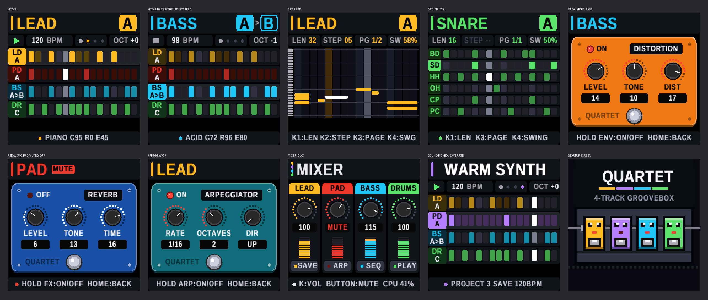
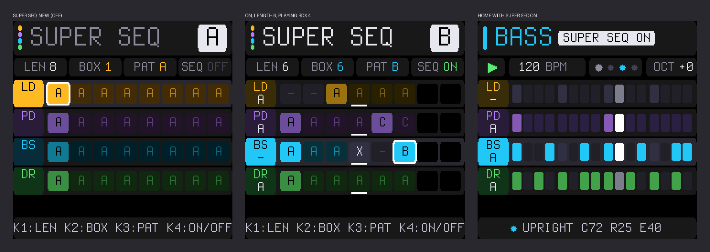
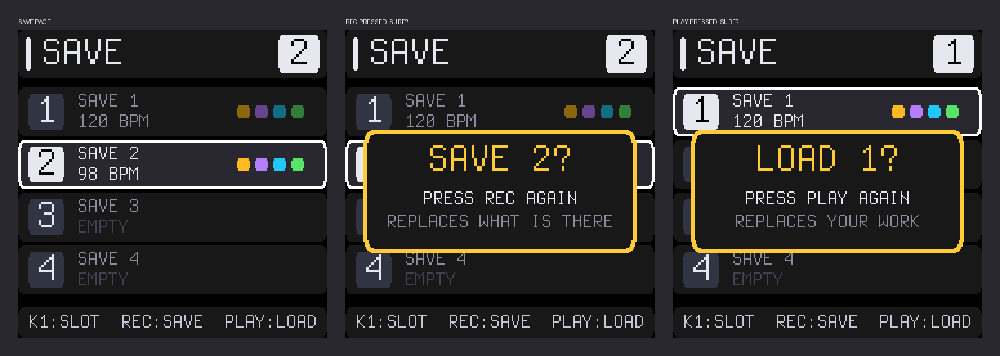

# QUARTET
## User guide for the M-VAVE FM-1

**Four instruments. One little band.**

Quartet is a four-track groovebox with **lead, pads/chords, bass and drums**, ten sounds and ten patterns per instrument, five effects pedals, live recording and a song arranger.

> **On a fresh install, a short demo groove is loaded** in pattern A of each instrument. Press **PLAY** to hear it and explore. To start from empty, go to the **home screen**, **hold REC for one second** until **CLEAR ALL?** appears, then **press REC again within three seconds** (any other button cancels). This erases the demo groove for good, but not your four saved projects.

## Instruments and home screen

**Lead** (gold) plays melodies; **pads** (violet) plays pads and chords; **bass** (cyan) plays basslines; **drums** (green) has six percussion voices. Muted instruments appear red.

Turn **ALGORITHM** to choose an instrument and **SELECT** to choose its sound or drum kit (two clicks per choice). Play the keys; for drums, the first six white keys play the six sounds. **OCT− / OCT+** change octave and **MASTER** sets overall volume. **PLAY** starts or stops all instruments from step one.

The **home screen** shows the selected instrument and pattern (A–J), tempo, beat lights, octave and four pattern rows. The playing step is highlighted; the bottom line shows the sound and knob settings. **A > C** means pattern C is queued after A.

On the home screen, **KNOB1** sets tempo. For lead, pads and bass, **KNOB2–4** control filter cutoff, resonance and filter envelope. For drums they adjust pitch, decay and level of the selected/last played drum. **PRESETS** chooses patterns, **SEQ** opens recording, **HOME** opens SUPER SEQ, **GLO** opens the mixer and **SAVE** opens project storage.

## Patterns and step recording

Each instrument has **ten patterns (A–J)**, each **16, 32, 48 or 64 steps** long. Turn **PRESETS** to choose one; changes during playback wait until the current pattern ends. **Hold ARP + turn PRESETS** to copy a pattern into the next letter.

Press **SEQ** to open the **step recorder** (SEQ lights up). Melodic instruments use a piano roll: move to a step and play keys to enter notes. For drums, the **first six black keys** choose a drum and the **white keys** toggle hits on the displayed steps.

| Control | Step recorder |
|---|---|
| **KNOB1** | Pattern length: 16 / 32 / 48 / 64 |
| **KNOB2 or SELECT** | Melodic step cursor |
| **KNOB3** | Page of 16 steps |
| **KNOB4** | Swing for the whole song: 50–66% |
| **OCT− / OCT+** | Drum step page |
| **REC tap / hold 1 s** | Melodic rest / clear selected pattern |
| **ARP tap** | Tie previous melodic note into next step |
| **SEQ / HOME** | Live recording / home |

While the music plays, a pattern longer than 16 steps is followed page by page on the display, unless you edit or change pages; it resumes following after three seconds. KNOB1 and KNOB3 take three clicks per setting.

## Live recording

Press **SEQ** again from the step recorder to open **LIVE** (SEQ blinks). **Tap REC** to record while playing the keys; tap it again to stop recording while playback continues. If stopped, recording starts playback at step one. **PLAY** stops playback and recording; **SEQ** returns to step editing; **HOME** returns home. Hold **REC** for one second to clear the pattern that is playing.

Notes are **added** to the current pattern and quantised to 16th-note steps; lengths are rounded to steps. Lead and pads allow up to four notes per step, bass one. Drums use the first six white keys. On this screen **KNOB1** changes length, **KNOB2** moves the melodic cursor and **KNOB3** changes page; **KNOB4** is unused.

## Sounds and sound editing

On the home screen, turn **SELECT** to choose a sound (in the step recorder it moves the cursor instead). Selecting another sound loads its preset settings, replacing your tweaks.

| # | Lead | Pads | Bass | Drums |
|---|---|---|---|---|
| 1 | Piano | Strings | Upright | Rock |
| 2 | Xylophone | Choir | Tuba | Hip-Hop |
| 3 | Brass | Acoustic Guitar | Slap | Mini Pops |
| 4 | Music Box | Organ | Plucked | CR-78 |
| 5 | Electric Guitar | Electric Piano | Fuzz | LM-1 |
| 6 | Hammond | Handpan | Synth Bass | 606 |
| 7 | Theremin | Warm Synth | FM | 808 |
| 8 | Synth | Glass Pad | Acid | 909 |
| 9 | Square Lead | Drone | Reese | Lo-Fi |
| 10 | Chiptune | Sweep | Wobble | Industrial |

The drum kits are synthesised, except the **LM-1**, which plays samples of a real Linn LM-1; on it the CLAP and PERC keys are its **low and high toms** (TL / TH on the drum grid). PERC is a different instrument per kit: a conga on CR-78, a shaker on Mini Pops and 606, a high tom on 808 and a low tom on Lo-Fi.

For optional deeper editing of lead, pads and bass, **hold ARP and turn SELECT** to switch pages:

| Page | KNOB1 | KNOB2 | KNOB3 | KNOB4 |
|---|---|---|---|---|
| **MAIN** | Tempo | Cutoff | Resonance | Filter envelope |
| **OSC** | Wave 1 | Wave 2 | Wave 2 tuning (−24 to +24) | Mix / FM amount |
| **ENV** | Attack | Decay | Sustain | Release |
| **LFO** | Rate | Depth | Target: pitch/filter/volume | Wave: tri/square/saw/random |

OSC waveforms: sine, triangle, saw, square, noise and FM. For drums, the main knobs adjust tempo, pitch, decay and level.

## Effects pedals and arpeggiator

The five top-row buttons are **effects pedals for the selected instrument**. **Tap** to open a pedal screen. Switch the pedal on with **KNOB1** (three clicks clockwise) and off again (three clicks anticlockwise), or **hold its button 0.5 seconds**; the button is lit while the pedal is on. **KNOB2–4** adjust it. **HOME, SEQ or SELECT** returns to the sequencer.

| Button | Pedal | KNOB1 | KNOB2 | KNOB3 | KNOB4 |
|---|---|---|---|---|---|
| **FX** | Reverb | On / off | Level | Tone | Time |
| **SEL** | Delay | On / off | Repeat rate | Echo | Intensity |
| **ENV** | Distortion | On / off | Level | Tone | Distortion |
| **LFO** | Chorus | On / off | Rate | Depth | Level |
| **EDIT** | Phaser | On / off | Rate | Depth | Feedback |

Most values run 0–20; delay timing uses 1/16–1/2 notes. Reverb, delay and chorus have **individual track amounts but shared timing/tone/modulation settings**. Distortion and phaser settings are per instrument.

The **arpeggiator** plays held notes or pattern chords in sequence. **Tap ARP** for its screen: **KNOB1** switches it on (three clicks clockwise) or off (three clicks anticlockwise), **KNOB2** rate (1/4–1/32), **KNOB3** octaves (1–4), **KNOB4** direction (up/down/random). **Holding ARP 0.5 seconds** also switches it on or off, and ARP is lit while it is on. KNOB2–4 take three clicks per change.

## SUPER SEQ: song arrangements

Press **HOME** from the home screen to open **SUPER SEQ**; press it again to return. Each instrument has its own row of up to **eight boxes**, and there are **ten songs (A–J)**. Each box plays its pattern once before moving on; instruments advance independently, so a 32-step pattern lasts twice as long as a 16-step pattern.

- **A–J:** play that pattern.
- **Blank:** repeat the previous pattern; blanks at the beginning are silent.
- **X:** rest; following blanks remain silent until another letter.

For example, `A...B.A.` plays **A A A A B B A A**. A new song starts with A followed by blanks, repeating A.

| Control | SUPER SEQ |
|---|---|
| **ALGORITHM** | Instrument row |
| **KNOB1** | Song length: 1–8 boxes |
| **KNOB2** | Select box |
| **KNOB3** | Blank / A–J / X |
| **KNOB4** | SUPER SEQ on/off |
| **PRESETS** | Song A–J |
| **ARP held + PRESETS** | Copy song into next letter |

When SUPER SEQ is on, it chooses the playing patterns instead of PRESETS. **PLAY** starts at box one; enabling SUPER SEQ during playback starts each instrument at box one when its current pattern finishes.

## Mixer and saving

**GLO** opens the mixer. **KNOB1–4** set the volumes of lead, pads, bass and drums. On the mixer, **SAVE / ARP / SEQ / PLAY** mute those instruments respectively (lit = playing). Press **GLO** again to close it. The mixer shows CPU load; if audio crackles, try disabling an effect.

Quartet **automatically remembers current work** after playback stops and the sound has been quiet for two seconds. Four separate save slots let you keep projects.

Press **SAVE**; **KNOB1** chooses slot 1–4. Press **REC twice** (second press within three seconds) to **save**, or **PLAY twice** to **load**. Loading replaces current work; an empty slot says **EMPTY**. Saving or loading stops playback. Press **SAVE** to leave the page.

To clear the current project, **hold REC on the home screen**, then confirm with REC. This resets patterns, sounds, effects, mixer, swing, arpeggiators and SUPER SEQ, **not** the four saved slots. MIDI channel and octave are retained.

## Complete control reference

| Control | Playing / home | Step recorder | Other screens |
|---|---|---|---|
| **ALGORITHM** | Select instrument (2 clicks) | Select instrument | SUPER SEQ: select row; LIVE: select instrument |
| **PRESETS** | Select pattern A–J (2 clicks) | Select pattern | SUPER SEQ: select song |
| **SELECT** | Select sound/kit (2 clicks) | Melodic step cursor | Pedal, arpeggiator, mixer, save: back home (and changes the sound if turned onto another); SUPER SEQ: nothing |
| **KNOB1–4** | Tempo + sound settings | Length / cursor / page / swing | LIVE: length / cursor / page / —; otherwise labelled settings |
| **Keys** | Play notes; drums: first six white keys | Melodic notes; drums: black keys choose voice, white keys toggle hits | LIVE: play and record |
| **OCT− / OCT+** | Change octave | Drum step page | Octave where applicable |
| **PLAY** | Start/stop from step one | Start/stop | LIVE: start/stop (stopping ends recording); mixer: mute drums; save: load |
| **SEQ** | Open step recorder | Open LIVE | LIVE: step recorder; mixer: mute bass; pedal/save: sequencer |
| **HOME** | Open SUPER SEQ | Return home | Return home / exit editing; SUPER SEQ: home |
| **REC** | Hold: CLEAR ALL?; press again to confirm | Tap: rest; hold: clear pattern | LIVE: record on/off or hold clear; save: save; pedal, arpeggiator, mixer, SUPER SEQ: hold clears the selected instrument's current pattern straight away (no question) |
| **ARP** | Tap: arpeggiator; hold: on/off | Tap: tie | Mixer: mute pads |
| **FX / SEL / ENV / LFO / EDIT** | Tap: pedal screen; hold: pedal on/off | Same | Pedal screen: KNOB1 on/off, KNOB2–4 adjust the effect |
| **GLO** | Open mixer | Open mixer | Close mixer |
| **SAVE** | Open save screen | Open save screen | Save screen: close; mixer: mute lead |
| **MASTER** | Overall volume | Overall volume | Overall volume |

**Shortcuts:** **ARP + PRESETS** copies a pattern or song to the next letter; **ARP + SELECT** chooses MAIN/OSC/ENV/LFO; **HOME + PRESETS** changes MIDI channel. **Hold OCT− while powering on** for USB rescue mode.

**Knob clicks:** ALGORITHM, SELECT and PRESETS use two clicks per choice; some settings take three. SELECT and PRESETS work by where the knob stands in a full turn (taken as 20 clicks); if their positions don't match your FM-1, `ALG_CLICKS` in `firmware/src/quartet.c` is a firmware setup option. ALGORITHM just counts clicks.
